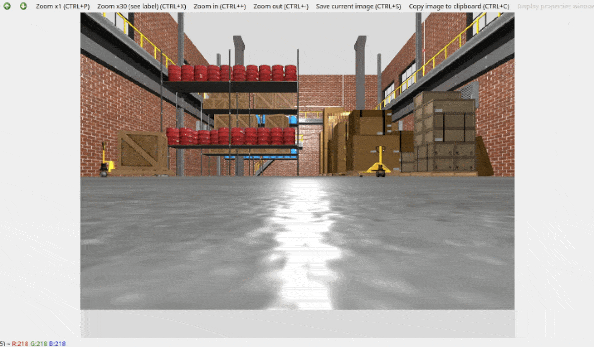
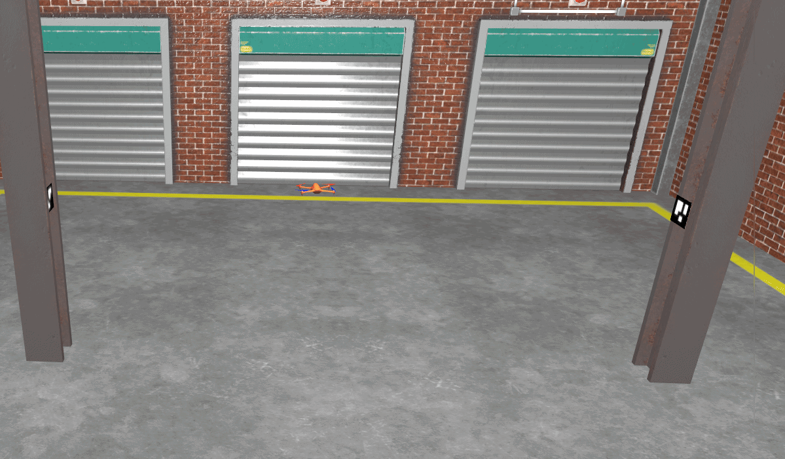

# Autonomous Quadcopter ArUco Marker Search, Approach & Return-to-Home

A ROS 2 and Gazebo simulation project featuring an autonomous **X3 Quadcopter** operating in an indoor warehouse environment (`depot.sdf`). The drone performs an automated takeoff to a target altitude, rotates in place to scan the environment using its forward-facing RGB camera, estimates the 3D pose of ArUco fiducial markers, approaches each marker to a $0.6\text{ m}$ distance using visual servoing, and autonomously returns to its initial takeoff coordinates to land.

## Demonstrations

| Onboard Camera View (`Aruco View`) | Top-Down Drone Flight View (Gazebo) |
| :---: | :---: |
|  |  |

---

## Overview & Key Features

* **8-State Autonomous Flight Controller:** Implements a complete Finite State Machine (`TAKEOFF` $\rightarrow$ `ASCEND` $\rightarrow$ `SEARCH` $\rightarrow$ `APPROACH` $\rightarrow$ `RETURN_HOME` $\rightarrow$ `LAND` $\rightarrow$ `FINISHED` $\rightarrow$ `OFF`) operating at $20\text{ Hz}$.
* **Real-Time 6-DOF ArUco Pose Estimation & TF Broadcasting:** Detects `DICT_4X4_50` markers from `/camera/image_raw`, computes 3D translation and rotation vectors (`tvecs`, `rvecs`), publishes camera-relative poses, and broadcasts dynamic transforms (`rgb_camera_optical_frame` $\rightarrow$ `aruco_marker_<id>`) to the ROS 2 `/tf` tree.
* **False-Positive Filtering:** Restricts valid detections to target marker IDs (`[23, 42]`) to prevent false-positive triggers caused by high-contrast warehouse wall and pillar textures.
* **Proportional Visual Servoing with Exponential Velocity Smoothing:** Aligns the quadcopter's heading with the marker center and regulates forward approach velocity down to a $0.6\text{ m}$ distance while applying a low-pass smoothing filter ($\alpha = 0.05$) to prevent pitch oscillations.
* **Odometry-Based Return-to-Home (RTH):** Records the initial takeoff pose $(x_0, y_0, \psi_0)$ from `/odom`, navigates back to the origin once all target markers have been visited, realigns with the initial yaw angle, and executes a controlled vertical descent.

---

## System Architecture

### 1. `aruco_pose_detector.py` (`ArucoPoseDetector`)
Handles visual perception and coordinate frame broadcasting:
* Subscribes to `/camera/image_raw` (`BEST_EFFORT` QoS) and `/camera/camera_info`.
* Runs `cv2.aruco.detectMarkers` and `cv2.aruco.estimatePoseSingleMarkers` for markers of physical size $0.3\text{ m}$.
* Converts Rodrigues rotation vectors into quaternions and broadcasts each valid marker's pose to `/tf` via `tf2_ros.TransformBroadcaster`.
* Publishes the marker's 3D pose (`geometry_msgs/msg/PoseStamped`) to `/detected_marker_pose` and its ID (`std_msgs/msg/Int32`) to `/detected_marker_id`.
* Displays a live OpenCV debug window (`Aruco View`) with rendered bounding boxes and 3D coordinate axes.

### 2. `sim_drone_controller.py` (`SimulationDroneController`)
Executes the flight state machine and velocity control via `/cmd_vel` (`geometry_msgs/msg/Twist`):

| State | Behavior |
| :--- | :--- |
| **`TAKEOFF`** | Applies open-loop upward velocity ($v_z = 0.8\text{ m/s}$) to clear the ground. | 
| **`ASCEND`** | Uses proportional altitude control to climb to the target hover height ($z_{\text{target}} = 2.0\text{ m}$). | $|z_{\text{target}} - z|
| **`SEARCH`** | Maintains altitude ($2.0\text{ m}$) while rotating in place ($\omega_z = 0.4\text{ rad/s}$) to scan for unvisited markers. |
| **`APPROACH`** | Regulates forward speed ($v_x$) and yaw rate ($\omega_z$) using camera-frame errors: $e_d = z_{\text{cam}} - 0.6\text{ m}$, $e_\psi = -x_{\text{cam}}$. |
| **`RETURN_HOME`** | Computes Euclidean distance and bearing to $(x_0, y_0)$ using `/odom`, rotates toward home, and flies back at $2.0\text{ m}$ altitude. | 
| **`LAND`** | Aligns yaw with initial heading $\psi_0$ and descends at $v_z = -0.3\text{ m/s}$. | 
---

## Control Law Details

During the **`APPROACH`** phase, the drone regulates its 3D position relative to the detected marker in `rgb_camera_optical_frame` (where $+Z$ points forward along the optical axis and $+X$ points right):

$$e_{\text{dist}} = z_{\text{marker}} - d_{\text{target}}, \quad e_{\text{yaw}} = -x_{\text{marker}}, \quad e_z = z_{\text{target}} - z_{\text{odom}}$$

Clamped proportional commands are computed and smoothed using an exponential moving average on the forward velocity to prevent sudden pitching:

$$\omega_z = \text{clip}(0.8 \cdot e_{\text{yaw}}, -0.4, 0.4)$$

$$v_{x,\text{raw}} = \text{clip}(0.4 \cdot e_{\text{dist}}, -0.3, 0.3)$$

$$v_x[k] = \alpha \cdot v_{x,\text{raw}}[k] + (1 - \alpha) \cdot v_x[k-1], \quad \alpha = 0.05$$

---

## Usage

Build the workspace and source the environment:

```bash
colcon build --symlink-install
source install/setup.bash
```

Run each of the following commands in a separate terminal (with `source install/setup.bash` sourced in each):

### 1. Launch the Gazebo Quadcopter Simulation
Spawns the X3 quadcopter inside the `depot.sdf` warehouse environment with ArUco markers `23` and `42` mounted on the pillars:
```bash
ros2 launch quadcopter_bringup quadcopter_basic.launch.xml
```

### 2. Start the ArUco Pose Detector Node
Starts the OpenCV detection pipeline, `/tf` broadcaster, and live `Aruco View` camera feed:
```bash
ros2 run amr_lv5 aruco_pose_detector
```

### 3. Start the Autonomous Drone Controller
Initiates takeoff, marker search/approach for both markers, and return-to-home landing:
```bash
ros2 run amr_lv5 sim_drone_controller
```

---

## Configurable Parameters & Constants

| Node | Parameter / Attribute | Default | Description |
| :--- | :--- | :--- | :--- |
| `aruco_pose_detector` | `marker_size` | `0.3` | Physical edge length (m) of the ArUco markers |
| `aruco_pose_detector` | `camera_topic` | `/camera/image_raw` | RGB image topic subscribed for marker detection |
| `aruco_pose_detector` | `camera_info_topic` | `/camera/camera_info` | Camera intrinsics topic |
| `sim_drone_controller` | `markers_to_visit` | `2` | Number of unique ArUco markers to visit before RTH |
| `sim_drone_controller` | `target_height` | `2.0` | Nominal hover and search altitude (m) |
| `sim_drone_controller` | `target_dist` | `0.6` | Standoff approach distance (m) from each marker |
| `sim_drone_controller` | `xy_tolerance` | `0.3` | Horizontal distance tolerance (m) for reaching home $(x_0, y_0)$ |